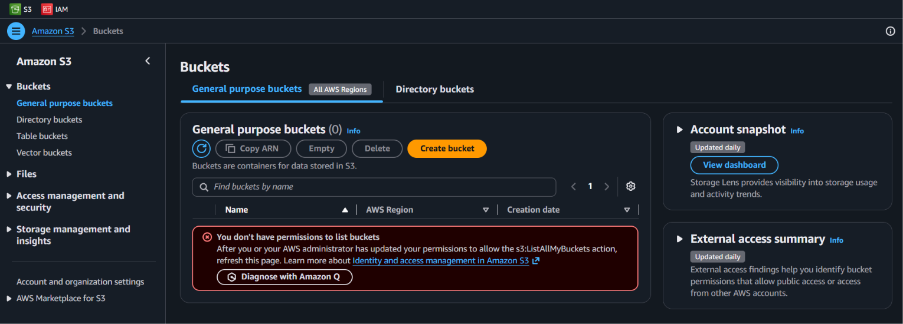
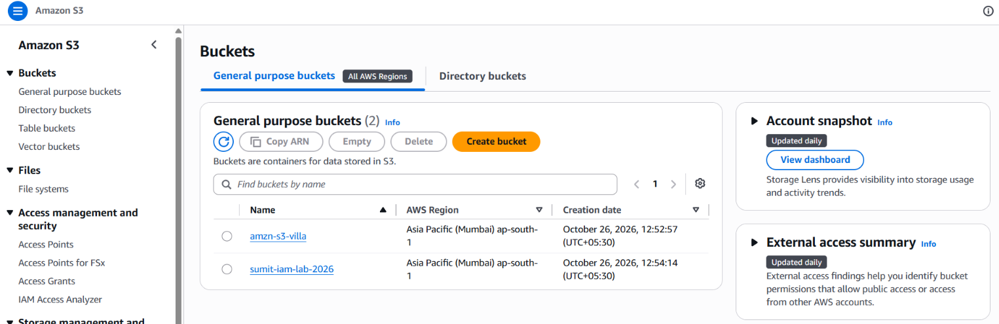
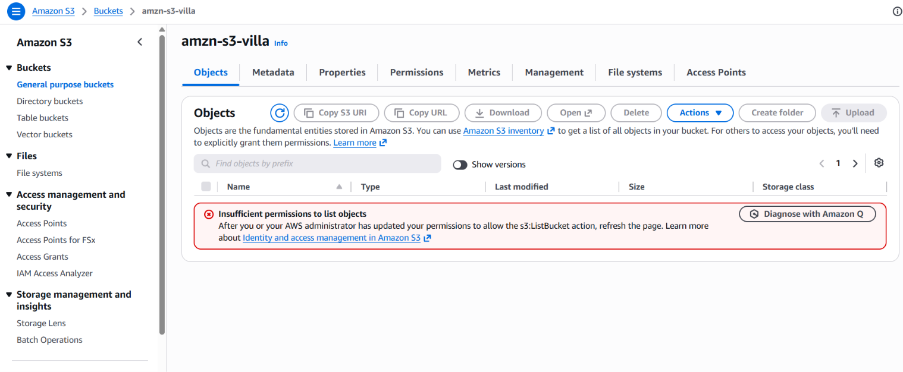
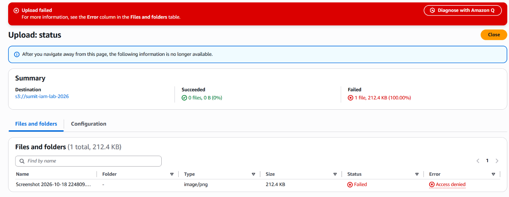
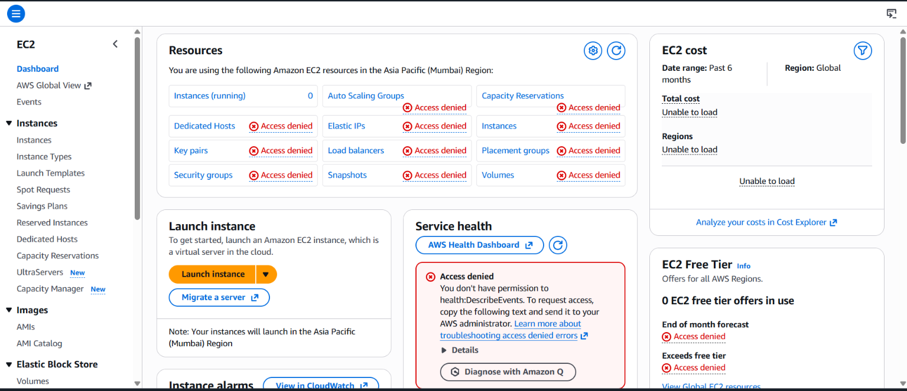

# AWS IAM Least-Privilege Lab

A hands-on lab where I created an IAM user who can only **read one S3 bucket**, then tested what it can and cannot do.

## Goal
Practice the principle of **least privilege**: give a user only the permissions needed and nothing more.

## Tools Used
- AWS IAM (users, groups, customer-managed policies)
- AWS S3
- IAM policy JSON

## What I Built
| Item | Value |
|---|---|
| IAM user | `lab-reader` (console access, **no access keys**) |
| IAM group | `s3-readers` |
| Policy | Read-only access to one bucket: `sumit-iam-lab-2026` |
| Region | Asia Pacific (Mumbai) `ap-south-1` |

## Steps
1. Created a private S3 bucket (`sumit-iam-lab-2026`) with Block Public Access on.
2. Created a customer-managed IAM policy allowing only `s3:ListBucket` and `s3:GetObject` on that bucket.
3. Created the group `s3-readers` and attached the policy.
4. Created the user `lab-reader` and added it to the group. No access keys were created.
5. Signed in as `lab-reader` and tested what was allowed and denied.

## Policies
- [`s3-readonly-v1-strict.json`](policies/s3-readonly-v1-strict.json): the first, strictest version
- [`s3-readonly-v2-console.json`](policies/s3-readonly-v2-console.json): adds `s3:ListAllMyBuckets` so the bucket shows in the console

## Test Results
| Test | Result |
|---|---|
| View the bucket list with the strict policy (v1) | Denied, no buckets shown |
| View the bucket list after adding `ListAllMyBuckets` (v2) | Allowed |
| Open the other bucket (`amzn-s3-villa`) | Denied |
| Upload a file to the lab bucket | Denied |
| Open the EC2 console | Denied |

## Screenshots
**Before: user could not list buckets (v1 policy)**

**After: bucket list works (v2 policy)**

**Denied: other bucket**

**Denied: upload**

**Denied: EC2**

## Key Lesson: A Real Least-Privilege Trade-off
The strict policy (v1) gave access to the bucket but the S3 console showed **"You don't have permissions to list buckets"**, because the console needs `s3:ListAllMyBuckets`.

Adding it (v2) fixed the console view, but it lets the user see the **names of all buckets** in the account, even those they cannot open. In a real company you decide based on need: stricter access vs. a friendlier console. Users can also reach the bucket directly by URL without that permission.

## Security Notes
- **No access keys** were created, since long-lived keys are a common source of leaks.
- The policy allows **read only**: no upload, delete, or other services.
- The test user had console access **without MFA**. For a short lab this is acceptable, but real users should always have MFA enabled.
- Resources were deleted after testing (user, group, policy, bucket).
- No credentials or account IDs are stored in this repo.

## Cleanup
Deleted the `lab-reader` user, the `s3-readers` group, the policy, and the lab bucket.

## Next Improvements
- Add an **explicit Deny** example and test how Deny overrides Allow
- Use an **IAM role** with temporary credentials instead of a user
- Enforce **MFA** with a policy condition
- Use the **IAM Policy Simulator** and **Access Analyzer** to validate the policy

## Author
**Sumit Jadhav**
YouTube:https://www.youtube.com/@officialhackwithsumit
LinkedIn :- www.linkedin.com/in/sumit-jadhav-67090b2a6